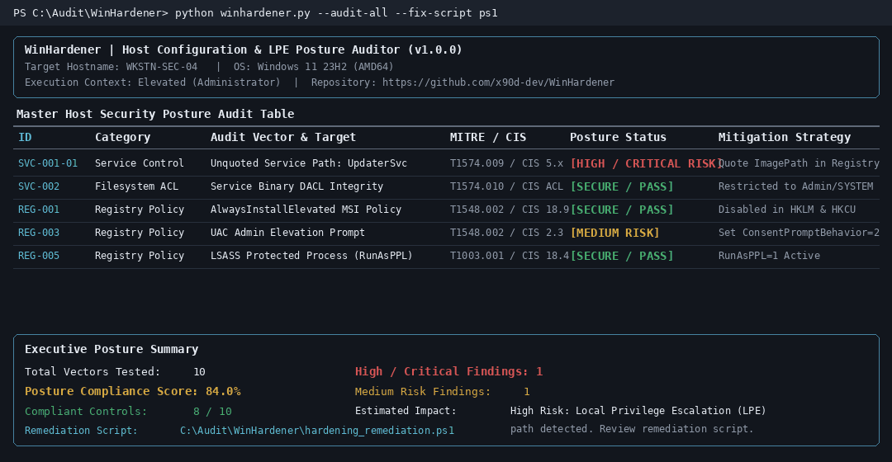

<div align="center">

# WinHardener: Automated Windows Local Privilege Escalation & Security Posture Auditor

[](https://github.com/x90d-dev/WinHardener)
[](https://github.com/x90d-dev/WinHardener)
[](https://github.com/x90d-dev/WinHardener)
[](https://github.com/x90d-dev/WinHardener/blob/main/LICENSE)
[](https://github.com/x90d-dev/WinHardener)

**Deterministic Host Auditing, Discretionary Access Control List (DACL) Verification, and Baseline Mitigation Strategy for Microsoft Windows.**

</div>

<p align="center"></p>

## Table of Contents

1. [Overview](#overview)
2. [Problem Statement: Privilege Escalation Risks & OS Misconfigurations](#problem-statement-privilege-escalation-risks--os-misconfigurations)
3. [Audit Vector Matrix (MITRE ATT&CK & CIS Benchmarks)](#audit-vector-matrix-mitre-attck--cis-benchmarks)
4. [Architecture Flow](#architecture-flow)
5. [Quickstart Guide](#quickstart-guide)
6. [Command Reference](#command-reference)
7. [Sample Remediation Output](#sample-remediation-output)
8. [Ethical & Administrative Disclaimer](#ethical--administrative-disclaimer)
9. [License](#license)

## Overview

**WinHardener** ([x90d-dev/WinHardener](https://github.com/x90d-dev/WinHardener)) is a standalone, pure-Python host security posture assessor designed for system administrators, blue-team engineers, and security auditors. It performs deterministic, read-only inspections of Windows service configurations, executable and directory Access Control Lists (ACLs), Registry elevation policies, Local Security Authority (LSA) memory protections, and PowerShell script logging settings.

Built strictly around the Python standard library (`winreg`, `ctypes`, `subprocess`) and `rich` for structured terminal reporting, WinHardener operates without external C++ build dependencies or invasive kernel drivers. It supports full bilingual output in **English (`--lang en`)** and **Bahasa Indonesia (`--lang id`)**, exports structured JSON compliance reports, and generates administrator-reviewable PowerShell (`hardening_remediation.ps1`) and Windows Batch (`hardening_remediation.bat`) remediation scripts.

## Problem Statement: Privilege Escalation Risks & OS Misconfigurations

Local Privilege Escalation (LPE) and post-compromise credential theft frequently rely on operational drift rather than software memory corruption. Common host misconfigurations include:

- **Service Path Interception ([MITRE T1574.009](https://attack.mitre.org/techniques/T1574/009/))**: When a Windows service configured to run as `NT AUTHORITY\SYSTEM` specifies an unquoted `ImagePath` containing spaces, the Service Control Manager (SCM) parses parent path segments sequentially, allowing binary planting in writable parent folders.
- **Permissive Service Binary & Directory DACLs ([MITRE T1574.010](https://attack.mitre.org/techniques/T1574/010/), [MITRE T1574.007](https://attack.mitre.org/techniques/T1574/007/))**: Third-party installers often leave `Modify (M)` or `Write (W)` permissions for `BUILTIN\Users`, `Authenticated Users`, or `Everyone` on service executables or directories listed in the system `PATH`, enabling direct binary replacement or DLL search order hijacking.
- **Elevation Control Policy Drift ([MITRE T1548.002](https://attack.mitre.org/techniques/T1548/002/))**: Enabling `AlwaysInstallElevated` in Group Policy or weakening User Account Control (`EnableLUA`, `ConsentPromptBehaviorAdmin`, `PromptOnSecureDesktop`) allows standard or medium-integrity processes to elevate without administrative consent on the secure desktop.
- **LSASS Memory Exposure & Missing Script Telemetry ([MITRE T1003.001](https://attack.mitre.org/techniques/T1003/001/), [MITRE T1059.001](https://attack.mitre.org/techniques/T1059/001/))**: Without Protected Process Light (`RunAsPPL`), Virtualization-Based Credential Guard (`LsaCfgFlags`), disabled WDigest cleartext caching (`UseLogonCredential=0`), and PowerShell ScriptBlock Logging (Event ID 4104), hosts remain exposed to credential harvesting and unlogged in-memory script execution.

## Audit Vector Matrix (MITRE ATT&CK & CIS Benchmarks)

Every check performed by WinHardener maps directly to documented adversary techniques in the [MITRE ATT&CK Framework](https://attack.mitre.org/) and hardening controls from the [CIS Microsoft Windows Desktop Benchmarks](https://www.cisecurity.org/benchmark/microsoft_windows_desktop) and [CIS Microsoft Windows Server Benchmarks](https://www.cisecurity.org/benchmark/microsoft_windows_server):

| Vector ID | Audit Vector | Target Subsystem | MITRE ATT&CK Reference | CIS Benchmark Control | Default Risk Tier |
| :--- | :--- | :--- | :--- | :--- | :--- |
| `SVC-001` | Unquoted Service Paths | `HKLM\SYSTEM\CurrentControlSet\Services\*\ImagePath` | [T1574.009](https://attack.mitre.org/techniques/T1574/009/) (Path Interception by Unquoted Path) | [CIS Windows Desktop 5.x](https://www.cisecurity.org/benchmark/microsoft_windows_desktop) (Service Path Integrity) | `HIGH` |
| `SVC-002` | Weak Service Binary Permissions | Service Executables (`icacls` DACL Inspection) | [T1574.010](https://attack.mitre.org/techniques/T1574/010/) (Services File Permissions Weakness) | [CIS Windows Server File ACLs](https://www.cisecurity.org/benchmark/microsoft_windows_server) | `CRITICAL` |
| `REG-001` | AlwaysInstallElevated Policy | `HKLM` & `HKCU\...\Windows\Installer\AlwaysInstallElevated` | [T1548.002](https://attack.mitre.org/techniques/T1548/002/) (Abuse Elevation Control Mechanism) | [CIS 18.9.85.2 (L1)](https://www.cisecurity.org/benchmark/microsoft_windows_desktop) | `CRITICAL` |
| `REG-002` | UAC Admin Approval Mode | `HKLM\...\Policies\System\EnableLUA` | [T1548.002](https://attack.mitre.org/techniques/T1548/002/) (Bypass User Account Control) | [CIS 2.3.17.8 (L1)](https://www.cisecurity.org/benchmark/microsoft_windows_desktop) | `CRITICAL` |
| `REG-003` | UAC Admin Prompt Behavior | `HKLM\...\Policies\System\ConsentPromptBehaviorAdmin` | [T1548.002](https://attack.mitre.org/techniques/T1548/002/) (Bypass User Account Control) | [CIS 2.3.17.2 (L1)](https://www.cisecurity.org/benchmark/microsoft_windows_desktop) | `MEDIUM` / `HIGH` |
| `REG-004` | UAC Secure Desktop Isolation | `HKLM\...\Policies\System\PromptOnSecureDesktop` | [T1548.002](https://attack.mitre.org/techniques/T1548/002/) (Bypass User Account Control) | [CIS 2.3.17.7 (L1)](https://www.cisecurity.org/benchmark/microsoft_windows_desktop) | `MEDIUM` |
| `REG-005` | LSA Protection (`RunAsPPL`) | `HKLM\SYSTEM\CurrentControlSet\Control\Lsa\RunAsPPL` | [T1003.001](https://attack.mitre.org/techniques/T1003/001/) (OS Credential Dumping: LSASS Memory) | [CIS 18.4.x LSA Protection](https://www.cisecurity.org/benchmark/microsoft_windows_desktop) | `HIGH` |
| `REG-006` | Credential Guard (`LsaCfgFlags`) | `HKLM\SYSTEM\CurrentControlSet\Control\Lsa\LsaCfgFlags` | [T1003.001](https://attack.mitre.org/techniques/T1003/001/) (OS Credential Dumping: LSASS Memory) | [CIS 18.9.5.x DeviceGuard](https://www.cisecurity.org/benchmark/microsoft_windows_desktop) | `MEDIUM` |
| `REG-007` | WDigest Cleartext Caching | `HKLM\...\SecurityProviders\WDigest\UseLogonCredential` | [T1003.001](https://attack.mitre.org/techniques/T1003/001/) (OS Credential Dumping: LSASS Memory) | [CIS 18.4.WDigest (L1)](https://www.cisecurity.org/benchmark/microsoft_windows_desktop) | `CRITICAL` |
| `ENV-001` | Writable System PATH Directories | `HKLM\...\Session Manager\Environment\Path` (`icacls`) | [T1574.007](https://attack.mitre.org/techniques/T1574/007/) (Path Interception by PATH Variable) | [CIS Environment Baseline](https://www.cisecurity.org/benchmark/microsoft_windows_desktop) | `HIGH` |
| `ENV-002` | Orphaned System PATH Entries | Non-existent directories in System `PATH` | [T1574.007](https://attack.mitre.org/techniques/T1574/007/) (Path Interception by PATH Variable) | [CIS Environment Baseline](https://www.cisecurity.org/benchmark/microsoft_windows_desktop) | `MEDIUM` |
| `ENV-003` | PowerShell Execution Policy | `HKLM\...\PowerShell\ExecutionPolicy` | [T1059.001](https://attack.mitre.org/techniques/T1059/001/) (Command and Scripting: PowerShell) | [CIS 18.9.95.x](https://www.cisecurity.org/benchmark/microsoft_windows_desktop) | `MEDIUM` |
| `ENV-004` | PowerShell ScriptBlock Logging | `HKLM\...\ScriptBlockLogging\EnableScriptBlockLogging` | [T1059.001](https://attack.mitre.org/techniques/T1059/001/) (Command and Scripting: PowerShell) | [CIS 18.9.95.1 (L1)](https://www.cisecurity.org/benchmark/microsoft_windows_desktop) | `MEDIUM` |

## Architecture Flow

```text
+-----------------------------------------------------------------------------+
|                         winhardener.py (CLI Entry)                          |
|  argparse: --audit-all | --audit-services | --audit-registry | --audit-acls |
|            --fix-script [ps1|bat] | --output [table|json] | --lang [en|id]  |
+--------------------------------------+--------------------------------------+
                                       |
         +-----------------------------+-----------------------------+
         |                             |                             |
         v                             v                             v
+-----------------------+   +-----------------------+   +-----------------------+
|  service_auditor.py   |   |  registry_auditor.py  |   |environment_auditor.py |
| --------------------- |   | --------------------- |   | --------------------- |
| - SCM Registry Scan   |   | - Installer Policy    |   | - System PATH Parser  |
| - Unquoted Path Logic |   | - UAC Token Controls  |   | - Directory DACL Test |
| - Binary icacls Check |   | - LSASS PPL & WDigest |   | - PowerShell Policies |
+-----------+-----------+   +-----------+-----------+   +-----------+-----------+
            |                           |                           |
            +---------------------------+---------------------------+
                                        |
                                        v
                     +-------------------------------------+
                     |       List[AuditFinding] (i18n)     |
                     +------------------+------------------+
                                        |
                       +----------------+----------------+
                       |                                 |
                       v                                 v
        +------------------------------+  +------------------------------+
        |     remediation_engine.py    |  |         reporter.py          |
        | ---------------------------- |  | ---------------------------- |
        | - Registry Checkpoint Backup |  | - Rich Status Header Panel   |
        | - hardening_remediation.ps1  |  | - Master Posture Audit Table |
        | - hardening_remediation.bat  |  | - Executive Summary & JSON   |
        +------------------------------+  +------------------------------+
```

### Repository Structure

```text
WinHardener/
├── winhardener.py              # Main CLI entry point and argument router
├── core/
│   ├── __init__.py             # Data models (AuditFinding) and EN/ID localization
│   ├── service_auditor.py      # Unquoted Service Paths & Service Binary DACL auditor
│   ├── registry_auditor.py     # AlwaysInstallElevated, UAC, LSA RunAsPPL & WDigest auditor
│   ├── environment_auditor.py  # System PATH ACL & PowerShell ScriptBlock Logging auditor
│   ├── remediation_engine.py   # Safe PS1 & BAT remediation script synthesizer
│   └── reporter.py             # Rich terminal renderer and JSON compliance exporter
├── assets/
│   └── demo.gif                # Terminal execution visual preview
├── requirements.txt            # Minimal pure-Python dependency (rich>=13.0.0)
├── run.bat                     # Automated Windows environment bootstrapper & launcher
├── run.sh                      # Automated POSIX/CI environment bootstrapper
├── LICENSE                     # MIT License (x90d-dev)
└── README.md                   # Technical documentation
```

## Quickstart Guide

### Option 1: One-Click Automated Execution on Windows (`run.bat`)

1. Clone or extract the repository:
   ```cmd
   git clone https://github.com/x90d-dev/WinHardener.git
   cd WinHardener
   ```
2. Double-click `run.bat` or execute it from an elevated Command Prompt (`Run as Administrator` is recommended for complete Registry and ACL visibility):
   ```cmd
   run.bat
   ```
   `run.bat` automatically verifies Python 3.9+, creates an isolated `.venv` virtual environment, installs `requirements.txt` once using `.venv\installed_marker.txt`, and executes `python winhardener.py --audit-all`.

### Option 2: Manual Virtual Environment Setup

```powershell
python -m venv .venv
.\.venv\Scripts\Activate.ps1
pip install -r requirements.txt
python winhardener.py --audit-all
```

## Command Reference

```text
usage: winhardener [-h] [--audit-all] [--audit-services] [--audit-registry]
                   [--audit-acls] [--fix-script {ps1,bat}]
                   [--fix-output FIX_OUTPUT] [--output {table,json}]
                   [--json-file JSON_FILE] [--lang {en,id}] [--version]
```

### Common Operational Examples

- **Run a comprehensive host audit in English (Default):**
  ```powershell
  python winhardener.py --audit-all --lang en
  ```
- **Run a comprehensive host audit in Bahasa Indonesia:**
  ```powershell
  python winhardener.py --audit-all --lang id
  ```
- **Audit only Windows Services and generate a reviewable PowerShell hardening script:**
  ```powershell
  python winhardener.py --audit-services --fix-script ps1
  ```
- **Audit Registry & ACL controls, export a Batch script, and save a forensic JSON report:**
  ```powershell
  python winhardener.py --audit-registry --audit-acls --fix-script bat --json-file host_posture_report.json
  ```
- **Emit raw JSON to stdout for SIEM / CI pipeline ingestion:**
  ```powershell
  python winhardener.py --audit-all --output json
  ```

## Sample Remediation Output

When invoked with `--fix-script ps1`, WinHardener generates `hardening_remediation.ps1` with automatic Registry recovery checkpoints and `-WhatIf` / `-Confirm` support (`SupportsShouldProcess`):

```powershell
#Requires -RunAsAdministrator
<#
.SYNOPSIS
    WinHardener Automated Host Hardening & LPE Remediation Script
.DESCRIPTION
    Generated by WinHardener v1.0.0 (https://github.com/x90d-dev/WinHardener)
    Review all configuration blocks carefully in a staging environment before execution.
#>

[CmdletBinding(SupportsShouldProcess=$true)]
param()

$ErrorActionPreference = 'Stop'
Write-Host '[WinHardener] Initializing host configuration hardening workflow...' -ForegroundColor Cyan

# 1. Create Registry Backup Directory
$BackupDir = Join-Path $PSScriptRoot ('reg_backup_' + (Get-Date -Format 'yyyyMMdd_HHmmss'))
New-Item -ItemType Directory -Path $BackupDir -Force | Out-Null
& reg.exe export 'HKLM\SOFTWARE\Microsoft\Windows\CurrentVersion\Policies\System' (Join-Path $BackupDir 'uac_policies.reg') /y | Out-Null
& reg.exe export 'HKLM\SYSTEM\CurrentControlSet\Control\Lsa' (Join-Path $BackupDir 'lsa_control.reg') /y | Out-Null

# --- [1] REG-003: UAC Admin Elevation Prompt Behavior (T1548.002 | CIS 2.3.17.2 (L1)) ---
if ($PSCmdlet.ShouldProcess('HKLM\SOFTWARE\Microsoft\Windows\CurrentVersion\Policies\System\ConsentPromptBehaviorAdmin', 'Apply REG-003 Remediation')) {
    Set-ItemProperty -Path 'HKLM:\SOFTWARE\Microsoft\Windows\CurrentVersion\Policies\System' -Name 'ConsentPromptBehaviorAdmin' -Value 2 -Type DWord -Force
    Write-Host '[APPLIED] REG-003 - UAC Admin Elevation Prompt Behavior' -ForegroundColor Green
}
```

Administrators can preview changes safely without modifying the host by running:
```powershell
.\hardening_remediation.ps1 -WhatIf
```

## Ethical & Administrative Disclaimer

WinHardener is a defensive security posture assessment and configuration auditing instrument developed for system administrators, security engineers, and authorized auditors.

1. **Authorization Requirement**: Only execute this tool on systems and networks where you hold explicit administrative or auditing authorization.
2. **Read-Only Default Operation**: WinHardener does not modify Registry keys, service configurations, or file permissions during auditing. Remediation scripts (`hardening_remediation.ps1` / `hardening_remediation.bat`) are exported as standalone files for human review and staging validation prior to execution.
3. **Operational Validation**: Modifying LSASS protection (`RunAsPPL`), User Account Control (UAC), or filesystem DACLs can impact legacy third-party drivers or non-standard applications. Always test generated remediation scripts in a non-production staging environment and verify Registry backups before deployment.

## License

Distributed under the **MIT License**. Copyright (c) 2026 [x90d-dev](https://github.com/x90d-dev). See [`LICENSE`](LICENSE) for full license text.
